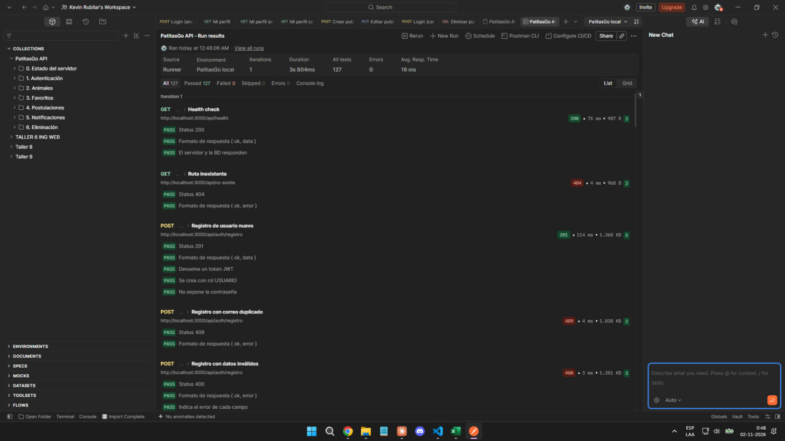

# Documentación de la API · PatitasGo

API REST del Avance 2. Construida con Node.js, Express y PostgreSQL, con autenticación JWT y control de acceso por roles.

- **URL base local:** `http://localhost:3000/api`
- **Formato:** JSON en el cuerpo de las peticiones y respuestas (`Content-Type: application/json`).
- **Autenticación:** cabecera `Authorization: Bearer <token>`. El token se obtiene en `/auth/login` o `/auth/registro` y dura 2 horas (`JWT_EXPIRES_IN`).
- **Colección Postman:** [`postman/PatitasGo.postman_collection.json`](../postman/PatitasGo.postman_collection.json) y su entorno [`postman/PatitasGo-local.postman_environment.json`](../postman/PatitasGo-local.postman_environment.json).

## Formato de respuesta

Todas las respuestas usan la misma estructura:

```json
{ "ok": true, "data": { }, "meta": { "pagina": 1, "limite": 12, "total": 3 } }
```

```json
{ "ok": false, "error": { "mensaje": "Datos de registro no válidos", "detalles": [{ "campo": "email", "mensaje": "Correo electrónico no válido" }] } }
```

`meta` solo aparece en listados paginados. `detalles` solo aparece cuando falla la validación de campos.

## Roles

| Rol | Quién es | Qué puede hacer |
| --- | --- | --- |
| Público | Visitante sin sesión | Ver el catálogo y la ficha de animales publicados |
| `USUARIO` | Persona que quiere adoptar | Postular, retirar sus postulaciones pendientes, favoritos, notificaciones |
| `ADMIN` | Administrador de un refugio | Gestionar los animales y las postulaciones **de su propio refugio** |

El rol y el refugio viajan dentro del token (`sub`, `rol`, `refugioId`). Un admin no puede ver ni modificar animales o postulaciones de otro refugio (responde `403`).

## Endpoints

### Estado

| Método | Ruta | Acceso | Descripción | Respuesta |
| --- | --- | --- | --- | --- |
| GET | `/health` | Público | Estado del servidor y de la conexión a PostgreSQL | 200 |

### Autenticación

| Método | Ruta | Acceso | Descripción | Respuesta |
| --- | --- | --- | --- | --- |
| POST | `/auth/registro` | Público | Crea una cuenta `USUARIO` y devuelve token | 201 · 400 · 409 · 429 |
| POST | `/auth/login` | Público | Inicia sesión y devuelve token | 200 · 400 · 401 · 429 |
| GET | `/auth/perfil` | Con token | Datos del usuario del token | 200 · 401 |

Ejemplo de registro:

```json
POST /api/auth/registro
{
  "nombre": "Camila",
  "apellido": "Morales",
  "email": "camila@ejemplo.cl",
  "password": "Clave1234",
  "telefono": "+56 9 1234 5678",
  "comuna": "Valparaíso"
}
```

Respuesta `201`:

```json
{
  "ok": true,
  "data": {
    "token": "eyJhbGciOiJIUzI1NiIs...",
    "usuario": { "id": 4, "nombre": "Camila", "apellido": "Morales", "email": "camila@ejemplo.cl", "rol": "USUARIO", "refugioId": null, "telefono": "+56 9 1234 5678", "comuna": "Valparaíso" }
  }
}
```

Reglas: nombre y apellido de 2 a 80 caracteres, correo válido y único, contraseña de 8 a 72 caracteres con mayúscula, minúscula y número.

### Animales

| Método | Ruta | Acceso | Descripción | Respuesta |
| --- | --- | --- | --- | --- |
| GET | `/animales` | Público | Catálogo de animales `DISPONIBLE`, paginado | 200 |
| GET | `/animales/gestion` | `ADMIN` | Todos los animales del refugio del admin (cualquier estado) | 200 · 401 · 403 |
| GET | `/animales/:id` | Público (token opcional) | Ficha de un animal. Los `BORRADOR` y `ARCHIVADO` solo los ve el admin de su refugio | 200 · 404 |
| POST | `/animales` | `ADMIN` | Crea una ficha en el refugio del admin (por defecto `BORRADOR`) | 201 · 400 · 401 · 403 |
| PUT | `/animales/:id` | `ADMIN` del refugio | Reemplaza los datos de la ficha | 200 · 400 · 403 · 404 |
| PATCH | `/animales/:id/estado` | `ADMIN` del refugio | Cambia solo el estado (publicar, ocultar, archivar) | 200 · 400 · 403 · 404 |
| DELETE | `/animales/:id` | `ADMIN` del refugio | Elimina la ficha si no tiene postulaciones | 204 · 403 · 404 · 409 |

Parámetros de consulta de `GET /animales`: `especie` (`PERRO`, `GATO`), `tamano` (`PEQUENO`, `MEDIANO`, `GRANDE`), `sexo` (`MACHO`, `HEMBRA`), `comuna` (comuna del refugio), `q` (busca por nombre), `pagina` (desde 1) y `limite` (1 a 50, por defecto 12). `GET /animales/gestion` acepta además `estado`.

Cuerpo de `POST` y `PUT`:

```json
{
  "nombre": "Toby",
  "especie": "PERRO",
  "raza": "Mestizo",
  "sexo": "MACHO",
  "edadMeses": 24,
  "tamano": "MEDIANO",
  "estado": "BORRADOR",
  "descripcion": "Perro tranquilo, se lleva bien con niños.",
  "salud": "Vacunas al día",
  "vacunado": true,
  "esterilizado": false,
  "fotoUrl": "https://images.unsplash.com/photo-1543466835-00a7907e9de1"
}
```

Estados de un animal: `BORRADOR` → `DISPONIBLE` (publicado) → `RESERVADO` (tiene una postulación aceptada) → `ADOPTADO`. `ARCHIVADO` lo saca de circulación sin borrar su historial. Los cambios a `RESERVADO` y `ADOPTADO` los hace el sistema al avanzar una postulación.

### Postulaciones

| Método | Ruta | Acceso | Descripción | Respuesta |
| --- | --- | --- | --- | --- |
| POST | `/postulaciones` | `USUARIO` | Postula a un animal `DISPONIBLE` | 201 · 400 · 403 · 404 · 409 |
| GET | `/postulaciones/mias` | `USUARIO` | Postulaciones del usuario | 200 |
| GET | `/postulaciones` | `ADMIN` | Postulaciones del refugio. Filtro opcional `estado` | 200 |
| GET | `/postulaciones/:id` | Dueño o `ADMIN` del refugio | Detalle con historial de estados | 200 · 403 · 404 |
| PATCH | `/postulaciones/:id/estado` | `ADMIN` del refugio | Avanza o rechaza la postulación | 200 · 400 · 403 · 404 · 409 |
| DELETE | `/postulaciones/:id` | `USUARIO` dueño | Retira una postulación que sigue `PENDIENTE` | 204 · 403 · 404 · 409 |

Cuerpo de `POST /postulaciones`:

```json
{
  "animalId": 1,
  "rut": "12.345.678-5",
  "telefono": "+56 9 5555 6666",
  "comuna": "Viña del Mar",
  "tipoVivienda": "Casa con patio",
  "otrasMascotas": "Ninguna",
  "motivacion": "Tengo patio cerrado y tiempo para paseos diarios.",
  "aceptaTerminos": true
}
```

El RUT se valida con el dígito verificador (módulo 11), la motivación necesita al menos 20 caracteres y no se permite más de una postulación activa por animal.

Transiciones permitidas en `PATCH /postulaciones/:id/estado`:

| Desde | Hacia | Efecto en el animal |
| --- | --- | --- |
| `PENDIENTE` | `EN_REVISION`, `RECHAZADA` | — |
| `EN_REVISION` | `ACEPTADA_EN_PROCESO`, `RECHAZADA` | Pasa a `RESERVADO` si se acepta |
| `ACEPTADA_EN_PROCESO` | `ADOPCION_COMPLETADA`, `RECHAZADA` | Pasa a `ADOPTADO`, o vuelve a `DISPONIBLE` si se rechaza |

Para `RECHAZADA` es obligatorio enviar `motivoRechazo` (mínimo 10 caracteres). Cada cambio queda en el historial y genera una notificación para el postulante. Una transición no permitida responde `409`.

```json
PATCH /api/postulaciones/1/estado
{ "estado": "RECHAZADA", "motivoRechazo": "Buscamos un hogar con más tiempo disponible." }
```

### Favoritos

| Método | Ruta | Acceso | Descripción | Respuesta |
| --- | --- | --- | --- | --- |
| GET | `/favoritos` | `USUARIO` | Animales guardados | 200 |
| POST | `/favoritos/:animalId` | `USUARIO` | Agrega un favorito (201 si es nuevo, 200 si ya existía) | 201 · 200 · 404 |
| DELETE | `/favoritos/:animalId` | `USUARIO` | Quita un favorito | 204 · 404 |

### Notificaciones

| Método | Ruta | Acceso | Descripción | Respuesta |
| --- | --- | --- | --- | --- |
| GET | `/notificaciones` | Con token | Avisos del usuario, más recientes primero | 200 |
| PATCH | `/notificaciones/:id/leida` | Con token | Marca un aviso como leído | 204 · 404 |

## Códigos de estado

| Código | Cuándo se usa |
| --- | --- |
| 200 | Consulta o actualización correcta |
| 201 | Recurso creado (incluye cabecera `Location` en animales y postulaciones) |
| 204 | Eliminación correcta, sin cuerpo |
| 400 | Datos inválidos o JSON mal formado (incluye `detalles` por campo) |
| 401 | Falta el token, es inválido o expiró, o las credenciales no coinciden |
| 403 | El rol no tiene permiso o el recurso pertenece a otro refugio |
| 404 | El recurso o la ruta no existe (también para fichas no publicadas vistas por el público) |
| 409 | Conflicto: correo duplicado, postulación repetida, transición no permitida o animal con postulaciones |
| 429 | Más de 10 intentos fallidos de login o registro en 15 minutos |
| 500 | Error interno; se responde un mensaje genérico sin detalles del servidor |

## Seguridad aplicada

- Contraseñas con hash **bcrypt** y comparación en tiempo constante, aunque el correo no exista.
- **JWT** firmado con `JWT_SECRET` (en `.env`, nunca en el repositorio) y con expiración.
- Middlewares `verificarToken`, `tokenOpcional` y `permitirRoles` en cada ruta protegida, más validación de pertenencia al refugio en los servicios.
- **helmet** para cabeceras HTTP seguras y `x-powered-by` desactivado.
- **CORS** limitado a los orígenes de `CORS_ORIGIN`.
- **express-rate-limit** en login y registro.
- Validación de todos los cuerpos de entrada, eliminación de `<` y `>` en textos (salvo contraseñas) y límite de 1 MB en el JSON.
- Consultas SQL **parametrizadas** (`$1`, `$2`, ...) para evitar inyección SQL, y transacciones en las operaciones que tocan varias tablas.

## Cómo probar con Postman

1. Carga la base de datos con `database/schema.sql` y `database/seed.sql`, y levanta la API con `npm run dev`.
2. En Postman, usa **Import** y selecciona los dos archivos de la carpeta `postman/`.
3. Elige el entorno **PatitasGo local** arriba a la derecha.
4. Abre la colección **PatitasGo API**, pulsa **Run** y ejecuta las carpetas en orden.

Los logins guardan los tokens en variables de la colección (`tokenAdmin`, `tokenAdmin2`, `tokenUsuario`), y los `POST` guardan los ids creados para las peticiones siguientes. La colección tiene 53 peticiones y 127 tests, que cubren casos correctos y errores esperados (401, 403, 404, 409 y validaciones). Se puede ejecutar varias veces seguidas sin recargar la base. Cada ejecución hace 3 intentos fallidos de autenticación a propósito, así que tras la tercera seguida hay que esperar 15 minutos o reiniciar la API para no recibir `429`.

Resultado de la ejecución en Postman (53 peticiones, 127 tests aprobados, 0 fallidos):



Usuarios de prueba del seed:

| Correo | Contraseña | Rol |
| --- | --- | --- |
| `admin@patitasgo.cl` | `Admin123!` | ADMIN · Huellas Felices |
| `admin.puerto@patitasgo.cl` | `Admin123!` | ADMIN · Patitas del Puerto |
| `tomas@ejemplo.cl` | `Usuario123!` | USUARIO |
